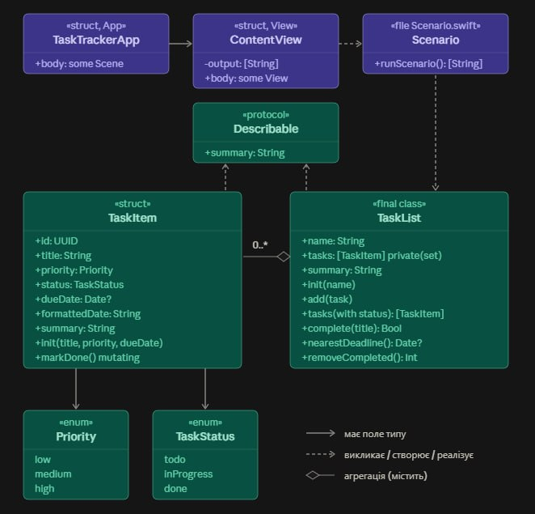
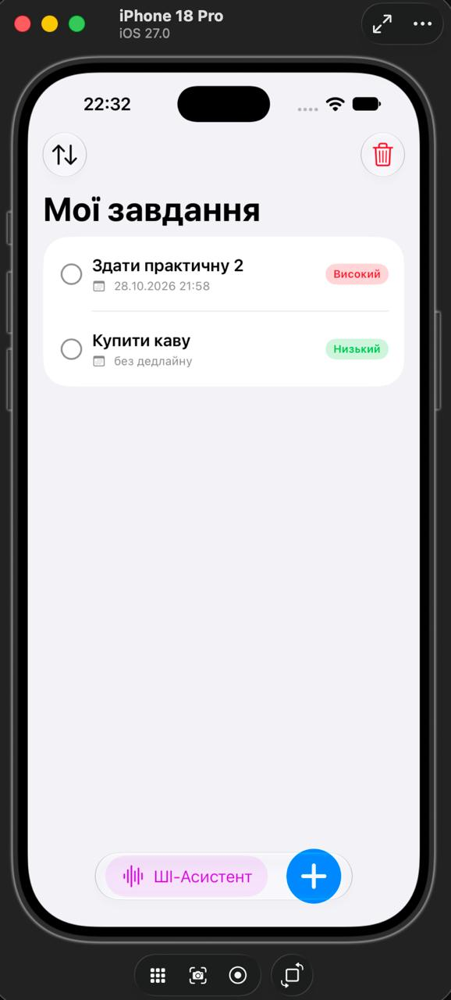
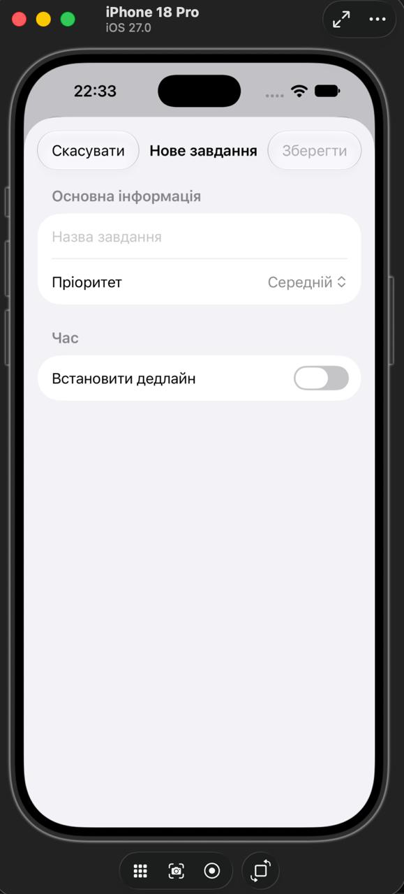
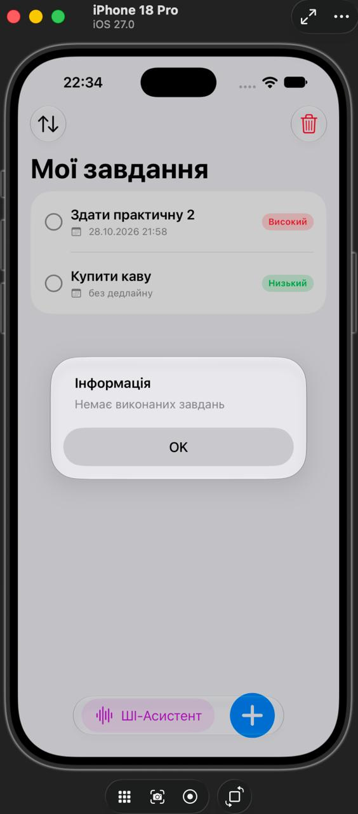
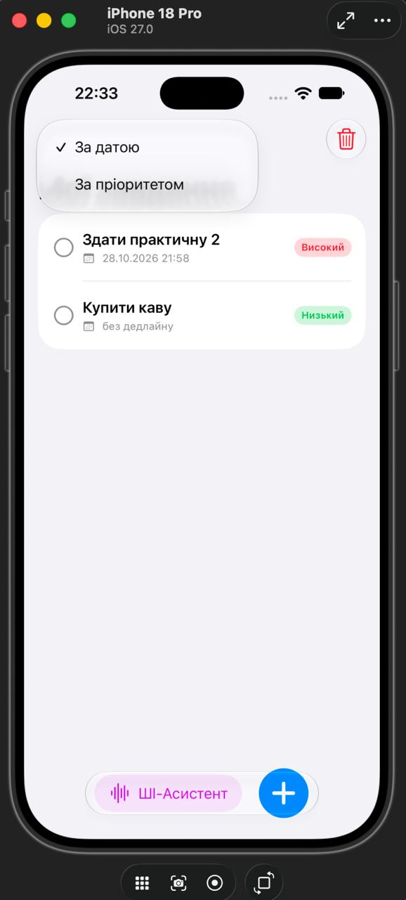

# TaskTracker

## Мета: 
створити основу iOS-застосунку, налаштувати контроль версій та застосувати базові конструкції Swift до задач проєкту
## Призначення
iOS-застосунок для керування особистими завданнями (диспетчер задач) з інтегрованим ШІ-асистентом для зручного голосового вводу.
**Призначення ШІ-асистента:** максимальне спрощення та прискорення взаємодії з додатком. Асистент дозволяє користувачу надиктовувати завдання голосом, автоматично розпізнаючи суть задачі, пріоритет та дедлайни.

## Чим наш продукт вирізняється на ринку
Головна конкурентна перевага нашого трекера — це наявність розумного голосового ШІ-асистента. На відміну від стандартних рішень, де користувач змушений витрачати час і вручну заповнювати всі поля (назва, дата, статус), наш додаток дозволяє просто сказати свої плани вголос. ШІ самостійно структурує інформацію та формує готову задачу.

## Користувач
Студент, який хоче впорядкувати навчальні завдання та дедлайни.

## Розподіл ролей у команді
- **Софія:** відповідає за зовнішній вигляд (UI/UX) застосунку, безпосередню роботу з кодом в Xcode та повне тестування проєкту (через наявність Mac).
- **Даша:** відповідає за розробку бекенд-частини та логіки роботи з даними.

## Основні сценарії
1. Створити завдання (назва, пріоритет, необов'язковий дедлайн).
2. Додати завдання до списку.
3. Позначити завдання виконаним.
4. Відфільтрувати завдання за статусом.
5. Дізнатися найближчий дедлайн.
6. Очистити список від виконаних завдань.
7. Голосовий ввід: користувач диктує завдання ШІ-асистенту.
8. Обробка ШІ: асистент аналізує голосовий запит, витягує з нього назву, пріоритет та дедлайн, і автоматично додає нове завдання.

## Предметна область (сутності)
- `TaskItem`: окреме завдання.
- `TaskList`: список завдань.

## Діаграма класів


## Як перевірити сценарій
1. Відкрити `TaskTracker.xcodeproj` у Xcode.
2. Обрати симулятор iPhone і натиснути Run (▶).
3. Результат сценарію з'явиться списком на екрані та в консолі Xcode.
Сценарій реалізовано у функції `runScenario()` (`Scenario.swift`).

## Налаштування проєкту
- Назва: TaskTracker
- Bundle Identifier: `com.<прізвище>.TaskTracker`
- Мінімальна версія iOS: 17.0


# Архітектура TaskTracker: VIPER

## Чому VIPER
У застосунку є не лише CRUD над списком завдань, а й окрема логіка розбору
вільного тексту (дедлайн, пріоритет, очищення назви), кілька способів
сортування та підміна джерела даних. VIPER розділяє це на п'ять ролей,
тому логіку ШІ-помічника можна змінювати й тестувати без UI.

**Обмеження:** багато протоколів і файлів для простого застосунку; більше
шаблонного коду, ніж у MVC/MVVM. У SwiftUI View не має окремого протоколу:
Presenter віддає стан через `@Published` (адаптація класичного VIPER).

## Схема компонентів

```mermaid
flowchart LR
    V[View<br/>TaskListView, AddTaskView] -->|дії користувача| P[Presenter<br/>TaskListPresenter]
    P -->|@Published стан| V
    P -->|команди| I[Interactor<br/>TaskListInteractor]
    I -->|output: didLoad / didFail| P
    P -->|навігація| R[Router<br/>TaskListRouter]
    R -->|створює| V
    I --> REPO[(TaskRepositoryProtocol)]
    I --> AI[AIAssistantProtocol]
    I --> S[TaskSortStrategy]
    REPO -.реалізація.-> MEM[InMemoryTaskRepository]
    AI -.реалізація.-> F[AIAssistantFacade]
    REPO --> E[Entity<br/>TaskItem, TaskList]
    B[TaskModuleBuilder] -.збирає й зв'язує.-> V
    B -.-> P
    B -.-> I
    B -.-> R
```

## Ролі компонентів

| Компонент | Файл | Відповідальність |
|---|---|---|
| View | `TaskListView`, `AddTaskView` | Малює стан, передає дії Presenter. Логіки немає |
| Interactor | `TaskListInteractor` | Бізнес-логіка: валідація, додавання, сортування, виклик ШІ |
| Presenter | `TaskListPresenter` | Перетворює `TaskItem` на `TaskRowViewModel`, керує станом екрана |
| Entity | `TaskItem`, `TaskList` | Модель даних |
| Router | `TaskListRouter` | Створює екрани, до яких переходить модуль |
| Data | `TaskRepositoryProtocol` | Доступ до даних за абстракцією |

## Сценарій «Додати завдання голосовим вводом»
1. Користувач вводить «Купити молоко завтра терміново», тисне «ШІ» (View).
2. View викликає `presenter.didSubmitVoiceInput(text)`.
3. Presenter викликає `interactor.addTask(fromVoiceInput:)`.
4. Interactor просить `AIAssistantFacade` розібрати текст, отримує `ParsedTask`.
5. Interactor додає `TaskItem` у репозиторій, сортує за поточною стратегією.
6. Interactor викликає `output.didLoad(tasks:)`, Presenter будує `rows`, View оновлюється.

# Патерни, SOLID, антипатерни

## Таблиця «патерн / принцип — компонент — призначення»

| Патерн / принцип | Компонент | Призначення |
|---|---|---|
| **Builder** (породжувальний) | `TaskModuleBuilder` | Створює й зв'язує View, Presenter, Interactor, Router в одному місці |
| **Facade** (структурний) | `AIAssistantFacade` | Один метод `processVoiceInput` ховає `DeadlineExtractor`, `PriorityDetector` та очищення заголовка |
| **Strategy** (поведінковий) | `TaskSortStrategy` та 3 реалізації | Сортування за датою / пріоритетом / назвою підміняється під час роботи |
| **Observer-подібна взаємодія** | `@Published` у Presenter | View автоматично оновлюється при зміні стану |
| SRP | Interactor, Presenter, Repository | Кожен має одну причину для змін |
| OCP | `TaskSortStrategy` | Нове сортування додається без зміни Interactor |
| LSP | `InMemoryTaskRepository` / `MockTaskRepository` | Взаємозамінні за протоколом |
| ISP | `DeadlineExtracting`, `PriorityDetecting`, окремі протоколи Presenter / Output | Малі протоколи під конкретну роль |
| DIP | `TaskListInteractor` | Залежить від `TaskRepositoryProtocol` і `AIAssistantProtocol`, а не від класів |
| DI | init-и Interactor, Facade, Builder | Залежності передаються ззовні |

## Патерни

**Builder.** Задача: VIPER-модуль складається з п'яти об'єктів із взаємними посиланнями; створення вручну в `TaskTrackerApp` розмазало б знання про структуру. Учасники: `TaskModuleBuilder`, `TaskListInteractor`, `TaskListPresenter`, `TaskListRouter`. Використання: `TaskTrackerApp` викликає `TaskModuleBuilder().build()`.

**Facade.** Задача: Interactor не повинен знати, як саме з тексту виділяється дедлайн і пріоритет. Учасники: `AIAssistantFacade` (фасад), `DeadlineExtractor`, `PriorityDetector` (підсистема). Використання: `TaskListInteractor.addTask(fromVoiceInput:)`.

**Strategy.** Задача: сортування змінюється під вибір користувача, а `if/switch` в Interactor ріс би з кожним новим варіантом. Учасники: `TaskSortStrategy` (інтерфейс), `SortByDateStrategy`, `SortByPriorityStrategy`, `SortByTitleStrategy`, контекст `TaskListInteractor`. Використання: `SortOption.strategy` → `setSortStrategy`.

Один компонент, `TaskListInteractor`, бере участь у двох рішеннях: він контекст Strategy і клієнт Facade. Ролі різні й не плутаються.

## SOLID на прикладі проєкту

- **S.** `TaskListPresenter` лише готує дані для екрана, `TaskListInteractor` лише правила, `InMemoryTaskRepository` лише зберігання. `DeadlineExtractor` і `PriorityDetector` розділені, бо змінюються з різних причин.
- **O.** Щоб додати сортування за статусом, створюємо `SortByStatusStrategy` і один `case` у `SortOption`. Код Interactor не змінюється.
- **L.** Interactor працює з `TaskRepositoryProtocol` однаково для `InMemoryTaskRepository` і `MockTaskRepository`; будь-яка стратегія сортування повертає масив тих самих елементів.
- **I.** Presenter реалізує окремі протоколи для команд View і для відповідей Interactor; `AIAssistantFacade` залежить від двох вузьких протоколів, а не від одного великого. `AIAssistantProtocol` має один метод, тому окремого розбиття не потребує.
- **D.** Interactor залежить від абстракцій. Конкретні класи вибирає лише `TaskModuleBuilder`.

### Заміна реалізації без переписування Interactor
```swift
let sut = TaskListInteractor(repository: MockTaskRepository(),
                             assistant: MockAIAssistant(result: nil))
```
Те саме у застосунку: `TaskModuleBuilder(repository: MockTaskRepository())` дає демонстраційну версію.

## DI та Dependency Inversion
**Dependency Inversion** це принцип проєктування: модулі високого рівня залежать від абстракцій, а не від деталей. **Dependency Injection** це техніка: залежність передається об'єкту ззовні (через `init`). DI можна застосувати й без DIP (передати конкретний клас), але разом вони дають змінну реалізацію.

## Перевірка на антипатерни

| Антипатерн | Де міг виникнути | Як уникнуто |
|---|---|---|
| God Object | Один `ContentView` з логікою, даними й UI (як у практичній 1) | Логіку винесено в Interactor, форматування в Presenter |
| Пряме поєднання UI з даними | View працювала б із `TaskList` | View бачить лише `TaskRowViewModel`; дані тільки через Repository |
| Прихована глобальна залежність | `Date()`, `Calendar.current` усередині `DeadlineExtractor` | Передаються через `init` (`calendar`, `now`) |
| Дублювання | Окрема логіка додавання для форми та ШІ | Голосовий ввід викликає той самий `addTask(title:priority:dueDate:)` |

**Виправлена проблема:** у практичній 1 `Scenario.runScenario()` створював `TaskList` і виконував усю логіку в одному місці, прив'язано до виводу в UI. Тепер той самий функціонал розділений на ролі, а `Scenario` залишено в `Legacy/` як історичну точку.

## Як тестувати логіку окремо від UI та даних
Interactor створюється з `MockTaskRepository` і `MockAIAssistant`, а Presenter у тесті замінюється `OutputSpy`. Жодного SwiftUI та реального сховища для цього не потрібно (див. `TaskListInteractorTests`).
   
## Результат роботи
Застосунок успішно переведено на архітектуру VIPER та інтегровано з повністю функціональним інтерфейсом на SwiftUI. 

**Практична реалізація UI та інтеграції:**
* **Ізоляція UI:** Екрани (`TaskListView`, `AddTaskView`) не містять жодної бізнес-логіки чи прямого доступу до `TaskItem`. Вони є абсолютно пасивними: лише відображають підготовлені дані (`TaskRowViewModel`) та передають події натискання кнопок у `TaskListPresenter`.
* **Чистота імпортів (захист від антипатернів):** Для забезпечення реактивності (`@Published`, `ObservableObject`) у шарі презентації (`TaskListPresenter`) використано фреймворк `Combine`. Відмова від `import SwiftUI` у файлах логіки на рівні компілятора гарантує неможливість змішування бізнес-правил із візуальними компонентами.
* **Інтеграція модулів:** У головній точці входу (`TaskTrackerApp`) застосовано породжувальний патерн через виклик `TaskModuleBuilder().build()`. Це ідеально інкапсулює збірку VIPER-модуля та реалізує Dependency Injection.

**Скриншоти готового застосунку:**





