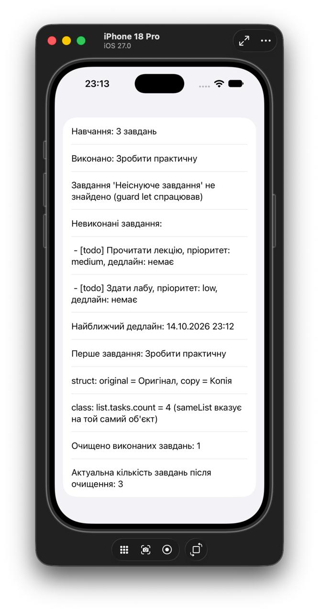

# TaskTracker

## Мета: 
створити основу iOS-застосунку, налаштувати контроль версій та застосувати базові конструкції Swift до задач проєкту
## Призначення
iOS-застосунок для керування особистими завданнями (диспечер задач).

## Користувач
Студент, який хоче впорядкувати навчальні завдання та дедлайни.

## Основні сценарії
1. Створити завдання (назва, пріоритет, необов'язковий дедлайн).
2. Додати завдання до списку.
3. Позначити завдання виконаним.
4. Відфільтрувати завдання за статусом.
5. Дізнатися найближчий дедлайн.
6. Очистити список від виконаних завдань.

## Предметна область (сутності)
- `TaskItem`: окреме завдання.
- `TaskList`: список завдань.

## Де що реалізовано
| Конструкція | Де |
|---|---|
| struct | `TaskItem` (`Models.swift`) |
| class | `TaskList` (`Models.swift`) |
| protocol | `Describable` (`Models.swift`) |
| enum | `Priority`, `TaskStatus` (`Models.swift`) |
| let / var | `let id`, `var title` у `TaskItem` |
| властивості, методи, init | `TaskItem`, `TaskList` |
| колекція | `TaskList.tasks: [TaskItem]` |
| optional | `TaskItem.dueDate: Date?`, `nearestDeadline() -> Date?` |
| безпечне розгортання | `guard let` у `complete(title:)`, `if let` у `runScenario()` та `formattedDate` |
| умовна конструкція | `if / else` у `runScenario()` та `formattedDate` |
| обробка колекції | `for`, `filter`, `compactMap`, `forEach`, `removeAll(where:)` (`Models.swift`, `Scenario.swift`) |

## Як перевірити сценарій
1. Відкрити `TaskTracker.xcodeproj` у Xcode.
2. Обрати симулятор iPhone і натиснути Run (▶).
3. Результат сценарію з'явиться списком на екрані та в консолі Xcode.
Сценарій реалізовано у функції `runScenario()` (`Scenario.swift`).

## Налаштування проєкту
- Назва: TaskTracker
- Bundle Identifier: `com.<прізвище>.TaskTracker`
- Мінімальна версія iOS: 17.0

## Результат роботи
